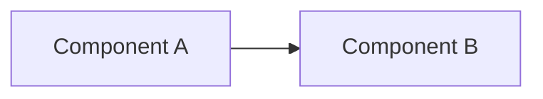

<!-- jarpa-format: 1 -->
# Architecture

## Overview
<Short narrative description of the system architecture>

## Key Components
- Component A
  - Responsibilities:
  - Interfaces:
- Component B
  - Responsibilities:
  - Interfaces:

## Data and Control Flows
<Explanation of how data and control move through the system>

## Diagrams

### Component Diagram (UML-like, Mermaid)

## Rationale (Current State)
- Decision: 

- Why: <reasoning>
- Trade-offs: <pros/cons>
